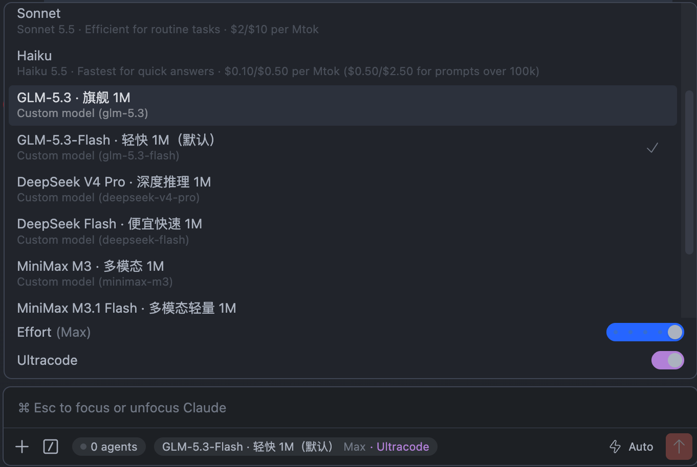
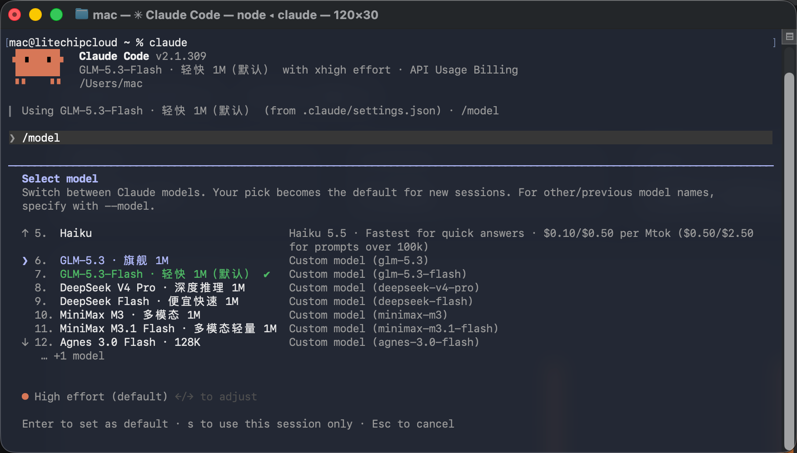

<div align="center">

# LiteGate Cli

**一条命令，把 Claude Code / Codex / ZCode / MiniMax Code 等 AI 编程工具全部接上 LiteGate**

[](https://www.litechipcloud.cn)
[](https://www.litechipcloud.cn)
[](https://www.litechipcloud.cn)
[](https://www.litechipcloud.cn)
[](LICENSE)

[English](#english) | 中文


</div>

---

> [!IMPORTANT]
> 本仓库是 **LiteGate 官方 CLI 与资源中心**（MIT 开源）。LiteGate 网关本身为商业服务，本仓库不包含其源码。

## ✨ 这是什么

**LiteGate** 是一站式大模型 API 网关：一个 Key 通吃 GLM / DeepSeek / MiniMax / Agnes 等 10 款模型，OpenAI 与 Claude 双协议兼容，长期免费模型，全线 1M 上下文。

**LiteGate Cli** 解决最后一个痛点：每款 AI 编程工具的自定义模型配置格式都不一样——

```bash
npx @litechipcloud/litegate init
```

一条命令：检测本机工具 → 粘贴 Key → 自动写入配置（增量模式不碰已有配置，自动备份可回滚）。

## ⚡ 快速开始

```bash
# 零安装直接用
npx @litechipcloud/litegate init

# 或全局安装
npm install -g @litechipcloud/litegate
litegate init
```

`init` 会：检测本机 AI 编程工具 → 让你选择要接入的工具 → 粘贴 [LiteGate Key](https://www.litechipcloud.cn)（控制台「词元页」创建）→ 自动配置并校验。

<details>
<summary>🔧 手动配置示例（CLI 做的事，透明可查）</summary>

**Claude Code**（`~/.claude/settings.json`）：

```json
{ "env": {
    "ANTHROPIC_BASE_URL": "https://www.litechipcloud.cn",
    "ANTHROPIC_AUTH_TOKEN": "sk-lcc-你的Key"
} }
```

**Codex CLI**（`~/.codex/config.toml`）：

```toml
model_provider = "litegate"
model = "minimax-m3.1-flash"

[model_providers.litegate]
name = "LiteGate"
base_url = "https://www.litechipcloud.cn/v1"
env_key = "LITEGATE_API_KEY"
wire_api = "chat"
```

</details>

## 📊 模型与定价（2026-10-31 起）

| 模型 | 上下文 | 价格 |
|---|---|---|
| **GLM-5.3-Flash** ⭐ | 1M | ¥0.38 / ¥1.33 每百万 |
| GLM-5.3 | 1M | ¥7.2 / ¥25.2 每百万 |
| DeepSeek Flash（4.1） | 1M | ¥1 / ¥4 每百万 |
| DeepSeek V4 Pro | 1M | ¥5 / ¥15 每百万 |
| MiniMax M3.1-Flash | 1M | ¥2 / ¥8 每百万 |
| MiniMax M3 | 1M | ¥2.1 / ¥8.4 每百万 |
| Agnes 3.0 / 2.5 Flash · Agnes 图像 2.5 | 128K | **长期免费** |
| WeMM-Embedding-2B（向量） | — | ¥0.2085 /次 |

> 全部按 token 计费（输入/输出），Agnes 与图像模型免费；实时价格以 `litegate models` 为准。
>
> 2026-10 Claude 全系（Opus/Sonnet/Haiku/Fable）已从网关下线，不再提供。
> 原先依赖 Claude 四档的工具（如 Claude Code）请用 `litegate init` 重新同步模型菜单。

## 🛟 命令

| 命令 | 功能 |
|---|---|
| `litegate init` | 交互式接入（检测→选择→配置） |
| `litegate status` | 查看本机 AI 工具与接入状态 |
| `litegate models` | 实时模型与价格列表 |
| `litegate switch <model>` | 一键切换默认模型 |
| `litegate init`（重复执行） | 刷新 Claude Code 的 `/model` 菜单（modelPicker） |
| `litegate rollback` | 一键回滚全部修改 |
| `litegate doctor` | 环境诊断 |

## 🔧 支持的 AI 编程工具

| 工具 | 状态 | 接入方式 |
|---|---|---|
| Claude Code | ✅ 支持 | 切换默认（env + /model 菜单） |
| Codex CLI | ✅ 支持 | 切换默认（托管段 + 模型目录） |
| ZCode | ✅ 深度集成 | 追加 provider 共存 |
| MiniMax Code | ✅ 支持 | 追加 provider 共存 |
| Claude Desktop | ✅ 支持 | 第三方推理 Gateway profile |
| Continue | ✅ 支持 | 追加模型条目共存 |
| CodeBuddy | ✅ 支持 | 追加模型条目共存（热加载） |
| WorkBuddy | ✅ 支持 | 追加模型条目共存（热加载） |
| Crush | ✅ 支持 | 追加 provider 共存（模型自动发现） |
| OpenCode | ✅ 支持 | 追加 provider 共存 |
| Zed | ✅ 支持 | 追加 provider 共存（key 走 `LITEGATE_API_KEY` 环境变量） |
| Qwen Code | ✅ 支持 | 切换默认（settings.json env 段） |
| Goose | ✅ 支持 | 追加 provider 共存（模型清单文件 + key 走 `LITEGATE_API_KEY` 环境变量） |
| Trae | 🔄 V0.2 适配中 | Key 经 safeStorage 加密，程序化写入待 PoC |
| Cursor | ⚠️ 受限 | 自定义 API Key 需 Cursor Pro 订阅，暂不自动配置 |

> CLI 只配置**你本机已安装**的工具——支持矩阵是兼容性清单，不是安装清单。
> 「追加共存」不改动工具里已有的其他供应商配置；「切换默认」只改默认端点/模型相关字段，
> 两者都自动备份、可 `litegate rollback` 一键回滚。
> **平台支持**：macOS / Linux / Windows 全量测试（三平台 CI 矩阵真机验证）；
> Claude Desktop 的写入仅 macOS（Windows 结构官方未证实，明确 skipped 不瞎写）。

## 🎛 Claude Code `/model` 菜单

`litegate init` 会把 LiteGate 在售的对话模型写进 Claude Code 的 `modelPicker`
（`~/.claude/settings.json`），`/model` 菜单直接列出网关模型，不用记名字。

**VSCode 扩展**



**CLI（`claude` → `/model`）**



菜单先列 Claude Code 内置档位，随后是 LiteGate 模型（标注 `Custom model`），
默认项带 `（默认）`。截图为真实环境：接入后内置 Claude 档位已不可用
（2026-10 Claude 已从网关下线），实际选择下面这些国产模型。

> 需要 Claude Code 2.1+；旧版本忽略该字段。配置只从用户级 settings 读取，
> 只影响本机、不写入项目仓库。模型增减后重跑 `litegate init` 即可刷新。

## 💡 为什么用 LiteGate Cli

- **批量接入**：一条命令，本机全部 AI 编程工具一次性接上 LiteGate——不用挨个工具手工改配置
- **模型列表实时同步**：新模型上线自动进入你的工具，无需手动填模型 ID 和价格
- **官方深度集成**：Key 创建深链、接入后自动烟测、ZCode 等国产工具深度支持
- **安全**：增量模式不动既有配置、自动备份、一键回滚、全开源可审计
- **隐私加固**：接入即写入 `CLAUDE_CODE_DISABLE_NONESSENTIAL_TRAFFIC=1`，
  关闭 Claude Code 的错误上报/反馈问卷等非必要流量——代码与对话只发往 LiteGate 网关，
  不经过境外服务器；已显式设值的用户配置不会被覆盖

## 🌐 English

**LiteGate** is an all-in-one LLM API gateway: one API key for GLM, DeepSeek, MiniMax, Agnes and 10 models in total — OpenAI & Anthropic compatible, permanently free models, 1M context across the lineup.

**LiteGate Cli** wires all your AI coding agents (Claude Code, Codex, ZCode, MiniMax Code and more) to LiteGate in one command:

```bash
npx @litechipcloud/litegate init
```

`litegate init` also populates Claude Code's `modelPicker`, so the `/model` menu lists the
gateway models with readable labels (see screenshots above).

See the Chinese documentation above for full details — the configuration examples are language-agnostic.

## 🔗 Links

- [控制台 / Console](https://www.litechipcloud.cn)
- [LiteGate 团队](https://www.litechipcloud.cn)

<div align="center">

**加入用户群，和云崽&芯宝一起开跑**


</div>

---

## License

[MIT](LICENSE)

